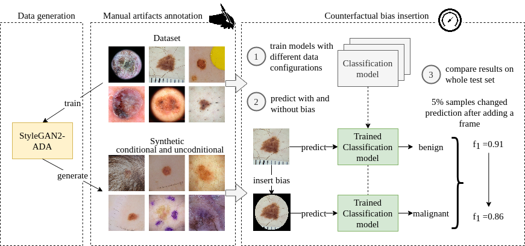
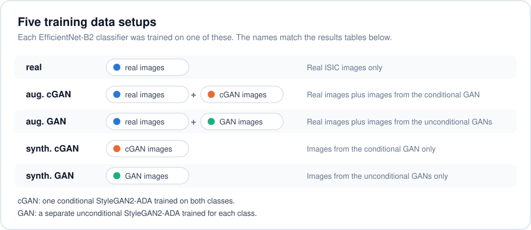
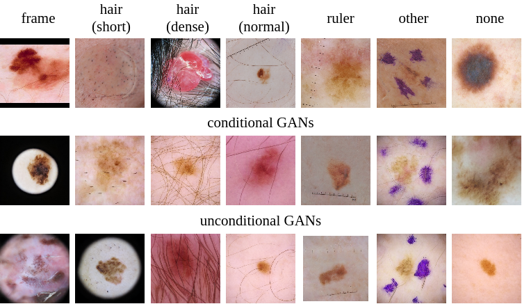
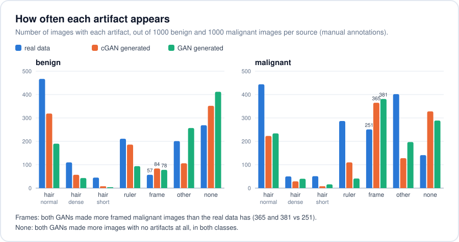
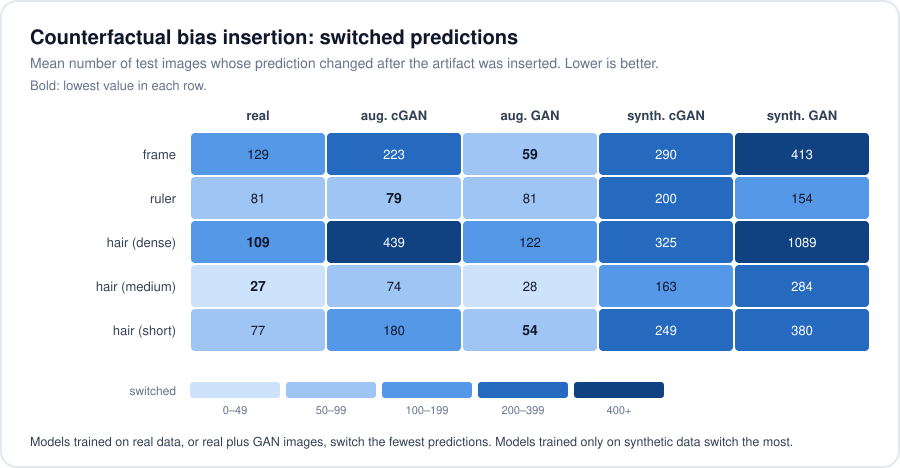

# The (de)biasing effect of GAN-based augmentation methods on skin lesion images

This repository contains the code and results for the MICCAI 2022 paper [The (de)biasing effect of GAN-based augmentation methods on skin lesion images](https://arxiv.org/abs/2206.15182).

The main goal of the experiments was to check whether GAN-generated data makes classification models more prone to bias. We used the ISIC skin lesion dataset, where the task is to tell malignant lesions from benign ones.

Generated data, annotations and additional results can be downloaded [here](https://drive.google.com/drive/folders/1ib7b5sopgUEK9TxqEPhgjD7XEdZXBvuV?usp=sharing).

The procedure has three main steps: data generation, manual annotation of artifacts, and counterfactual bias insertion.



## Table of Contents

- [Repository contents](#repository-contents)
- [Synthetic data generation and classification](#synthetic-data-generation-and-classification)
- [Annotated examples](#annotated-examples)
- [Inheritance bias in GANs](#inheritance-bias-in-gans)
- [Descriptive statistics](#descriptive-statistics)
- [Counterfactual bias insertion](#counterfactual-bias-insertion)
  - [How CBI works](#how-cbi-works)
  - [Running CBI](#running-cbi)
  - [Results](#results)
- [License](#license)
- [Citing](#citing)

## Repository contents

This repository holds the counterfactual bias insertion (CBI) code. GAN training, image generation and classifier training use the [aidotse/stylegan2-ada-pytorch](https://github.com/aidotse/stylegan2-ada-pytorch) repository (see the next section).

```
├── counterfactual_bias_insertion.py   # runs CBI on trained classifiers and saves the statistics
├── model.py                           # Net: EfficientNet-B2 with a 500-unit layer and one output
├── torch_transforms.py                # test transforms, with and without bias insertion
├── transforms/
│   ├── random_frame_transform.py      # RandomFrameTransform: pastes a frame mask over the image
│   └── random_hair_transform.py       # RandomHairTransform: copies hair or ruler pixels from a source image
├── im/                                # README figures
├── requirements.txt
└── LICENSE
```

## Synthetic data generation and classification



Image generation used a modified StyleGAN2-ADA implementation from NVIDIA Research, available at [aidotse/stylegan2-ada-pytorch](https://github.com/aidotse/stylegan2-ada-pytorch).

We trained a conditional GAN (cGAN) for both classes, and an unconditional GAN for each class separately. Training and validation consist of these steps:

1. [Prepare the ISIC 2020 dataset](https://github.com/aidotse/stylegan2-ada-pytorch#preparing-datasets)

    For cGAN training, also create a file called `dataset.json` in the dataset root folder. It has this structure:
    ```json
    {
        "labels": [
            ["ISIC_0000002.jpg", 1],
            ["ISIC_0000004.jpg", 1],
            ...
            ["ISIC_9998240.jpg", 0]
        ]
    }
    ```
    Label 0 means benign and 1 means malignant. Add an entry for every image in the dataset.
    If `dataset.json` is missing, the dataset is treated as having no class labels.
2. [Train StyleGAN2-ADA with or without labels](https://github.com/aidotse/stylegan2-ada-pytorch#training-new-networks---nvidia-resources)
   ```bash
   python train.py --outdir=~/training-runs --data=~/mydataset.zip --gpus=1          # unconditional
   python train.py --outdir=~/training-runs --data=~/mydataset.zip --gpus=1 --cond=1 # conditional
   ```
3. [Train EfficientNet-B2 on real, real + synthetic, or only synthetic data](https://github.com/aidotse/stylegan2-ada-pytorch#classification-with-efficientnet-b2)

   Example with real data plus 0 synthetic benign images and 15k synthetic malignant images:
   ```bash
   python melanoma_classifier.py --syn_data_path=~/generated/ \
    --real_data_path=~/melanoma-external-malignant-256/ \
    --synt_n_imgs="0,15"
   ```
4. [Make predictions on real data with the trained classifier](https://github.com/aidotse/stylegan2-ada-pytorch/blob/main/predict.py)
   ```bash
   python predict.py --data_path=~/melanoma-external-malignant-256/ \
    --model_path=classifier_efficientnet-b2_nonconditional_train_reals+15melanoma.pth \
    --seeds 0-24999
   ```

## Annotated examples

Based on the literature, we selected four types of artifacts to annotate: hair, frames, rulers and other.

* **Hair:** thick and thin hair of any colour, from light blond to black. We also annotated the hair type: normal, dense (covering a large part of the image) and short (shaved hair).
* **Frames:** black and white round markings around the lesion, black rectangle edges, and vignettes.
* **Rulers:** rulers of any shape and colour, fully or partly visible.
* **Other:** any less common artifact, such as dermatoscopic gel or air bubbles, ink or surgical pen markings, patches and papers, dates and numbers, background parts, light reflections and dust.


The annotations were made by a trained professional who has worked with the ISIC collection and its biases for over 4 years. We measured inter-annotator agreement on a small subsample of the data. The mean Cohen's kappa was over 70%, highest for rulers and lowest for other.

## Inheritance bias in GANs

Bias is often defined as a systematic error from wrong assumptions in the learning algorithm. In this work, we focused on bias in data and in models. By "bias in data" we mean four common data biases in machine learning:

* **observer bias:** annotators use personal opinion to label data
* **sampling bias:** not all samples have the same chance of being sampled [[N. Mehrabi et al.]](https://dl.acm.org/doi/abs/10.1145/3457607)
* **data handling bias:** the way the data is handled distorts the classifier's output
* **instrument bias:** imperfections in the instrument or method used to collect the data

By "bias in models" we mean algorithmic bias in the broad sense. Some sources define algorithmic bias as an algorithm amplifying existing inequities in, for example, socioeconomic status, race or ethnic background.



## Descriptive statistics



The statistics show that GANs amplified strong biases. Large black frames, a common dermoscopy artifact, were never generated in benign lesions, but frames were more common in the generated malignant images than in the real ones. At the same time, the synthetic data had many more images with no artifacts. This, together with a manual review of the generated artifacts, suggests that GANs also have a debiasing effect, especially for small, rare biases.

We also share the manual annotations of the artifacts, so they can serve as a benchmark for further studies. Future work will focus on generating unbiased data by learning a direction for each bias in the latent space, to create a fairer and more diverse dataset.

Number of images with each artifact, out of 1000 images per class and source:

| data | class | hair (normal) | hair (dense) | hair (short) | ruler | frame | other | none | total |
|------|-------|--------------:|-------------:|-------------:|------:|------:|------:|-----:|------:|
| Real | ben   | 467 | 110 | 45 | 211 |  57 | 201 | 269 | 1000 |
|      | mal   | 444 |  50 | 51 | 287 | 251 | 402 | 141 | 1000 |
| cGAN | ben   | 319 |  57 |  8 | 186 |  84 | 106 | 352 | 1000 |
|      | mal   | 223 |  29 |  8 | 110 | 365 | 128 | 328 | 1000 |
| GAN  | ben   | 190 |  43 |  4 |  94 |  78 | 257 | 412 | 1000 |
|      | mal   | 234 |  40 | 16 |  41 | 381 | 197 | 289 | 1000 |

## Counterfactual bias insertion

### How CBI works

Counterfactual bias insertion (CBI) answers one question: **if the only change to an image is an added artifact, does the classifier change its prediction?**

A classifier that relies on the lesion should give the same answer with or without a frame. A classifier that has learned "frame means malignant" will switch some benign predictions to malignant once a frame is added. CBI counts these switches.

For every test image, CBI makes two versions:

- the **original** image
- a **counterfactual** image: the same image with one artifact inserted

Both go through the same classifier. If the predicted classes differ, the image counts as a **switched prediction**.

The artifacts are inserted with masks:

- **Frames** (`RandomFrameTransform`): a frame mask is resized to the image and pasted over it.
- **Hair and rulers** (`RandomHairTransform`): each mask marks where the hair or ruler is in a real source image. Those pixels are copied from the source image onto the test image.

In a CBI run, every test image gets the artifact, and the same mask is used for all images. The script then repeats the run for every mask of that artifact type. Results are reported as the mean, standard deviation and median over masks, so one unusual mask does not decide the outcome.

**Metrics**

| Metric | Meaning |
|---|---|
| `switched` | Number of test images whose predicted class changed after inserting the artifact. |
| `ben_to_mal` | Switches from benign to malignant. |
| `mal_to_ben` | Switches from malignant to benign. |
| `mean`, `median`, `max`, `min` | Statistics of the absolute change in the predicted malignant probability. |
| `f1`, `recall`, `precision` | Scores on the original test images. |
| `f1_aug`, `recall_aug`, `precision_aug` | Scores on the counterfactual test images. |

**How to read the results**

- A low `switched` count means the artifact has little effect on the classifier.
- A high `switched` count means the classifier relies on the artifact.
- The direction shows what the classifier has learned. Frames are more common in malignant images, so a classifier that relies on frames shows a high `ben_to_mal` count.
- A large drop from `f1` to `f1_aug` means the artifact also hurts accuracy, not only individual predictions.

### Running CBI

Install the requirements (a CUDA GPU is required):

```bash
pip install -r requirements.txt
```

Prepare the data:

```
test_data/                  # test images, one folder per class
├── benign/
└── malignant/
models/                     # trained classifiers (state dicts of model.Net), *.pth
cbi_masks/                  # one folder per bias type, named as in --augmentation_names
├── frame/
├── hair-short/
├── hair-medium/
├── hair-dense/
└── ruler/
hair_sources/               # source images for hair and ruler masks, same file names as the masks
```

Run:

```bash
python counterfactual_bias_insertion.py \
  --test_data_dir test_data/ \
  --models_dir models/ \
  --cbi_masks_dir cbi_masks/ \
  --hair_source_dir hair_sources/ \
  --save_results_path statistics.csv
```

| Argument | Default | Meaning |
|---|---|---|
| `--test_data_dir` | required | Test images, one folder per class (`benign`, `malignant`). |
| `--models_dir` | required | Folder with trained `.pth` classifiers. Every file is tested. |
| `--cbi_masks_dir` | required | Folder with one subfolder of masks per bias type. |
| `--hair_source_dir` | none | Source images for hair and ruler masks. Needed for every bias type except `frame`. |
| `--augmentation_names` | `frame hair-short hair-medium hair-dense ruler` | Bias types to test. |
| `--save_results_path` | `statistics.csv` | Output file. |
| `-b`, `--batch-size` | 16 | Batch size. |

The output CSV has one row per model, bias type and mask, with the columns `model, aug_type, aug_number, mean, median, max, min, switched, mal_to_ben, ben_to_mal, f1, f1_aug, recall, recall_aug, precision, precision_aug`. `aug_number` is the mask file name.

### Results



The CBI analysis supports the idea that GANs can both add and remove bias. The study showed an inverse relationship between a model's accuracy and its robustness to bias: a well-trained model, even one trained on biased data, is less likely to switch predictions after a bias is inserted. The best results for both accuracy and robustness came from models trained on real data, or on real data augmented with images from unconditional GANs. GANs can be used to enrich data, but they should be monitored, because they can amplify existing inequities in the data.

Switched predictions are the mean, standard deviation and median over masks. The percentages are the share of images in the starting class. F1 scores are in %.

| bias | data | switched (mean) | switched (std) | switched (median) | mal to ben | ben to mal | F1 | F1 with bias | F1 (std) | F1 (mean) |
|------|------|---:|---:|---:|---:|---:|---:|---:|---:|---:|
| frame | real | 129 | 119.39 | 77 | 24 (2.39%) | 104 (1.60%) | 91.99 | 88.97 | 4.01 | 90.48 |
| | aug. cGAN | 223 | 55.25 | 199 | 40 (3.88%) | 183 (2.81%) | 89.65 | 84.93 | 2.26 | 87.29 |
| | aug. GAN | 59 | 16.07 | 51 | 22 (2.19%) | 37 (0.57%) | 91.52 | 90.49 | 0.61 | 91.01 |
| | synth. cGAN | 290 | 43.97 | 271 | 125 (12.24%) | 165 (2.54%) | 80.39 | 79.28 | 1.26 | 79.84 |
| | synth. GAN | 413 | 33.17 | 404 | 297 (29.13%) | 116 (1.78%) | 76.04 | 74.99 | 0.82 | 75.51 |
| ruler | real | 81 | 86.76 | 29 | 76 (7.48%) | 5 (0.07%) | 91.99 | 88.59 | 4.30 | 90.29 |
| | aug. cGAN | 79 | 44.21 | 69 | 55 (5.43%) | 24 (0.37%) | 89.65 | 89.18 | 1.08 | 89.41 |
| | aug. GAN | 81 | 96.08 | 24 | 78 (7.60%) | 3 (0.05%) | 91.52 | 87.05 | 5.81 | 89.29 |
| | synth. cGAN | 200 | 137.26 | 151 | 194 (18.96%) | 6 (0.09%) | 80.39 | 78.31 | 5.11 | 79.35 |
| | synth. GAN | 154 | 109.89 | 107 | 65 (6.33%) | 90 (1.38%) | 76.04 | 74.69 | 1.82 | 75.36 |
| hair (dense) | real | 109 | 33.63 | 118 | 90 (8.81%) | 19 (0.29%) | 91.99 | 88.42 | 1.62 | 90.20 |
| | aug. cGAN | 439 | 269.40 | 459 | 96 (9.38%) | 344 (5.28%) | 89.65 | 78.85 | 9.04 | 84.25 |
| | aug. GAN | 122 | 28.48 | 113 | 74 (7.29%) | 48 (0.73%) | 91.52 | 87.03 | 1.42 | 89.28 |
| | synth. cGAN | 325 | 71.38 | 357 | 272 (26.66%) | 52 (0.81%) | 80.39 | 80.00 | 1.43 | 80.20 |
| | synth. GAN | 1089 | 651.43 | 1101 | 61 (5.97%) | 1028 (15.79%) | 76.04 | 59.94 | 10.27 | 67.99 |
| hair (medium) | real | 27 | 7.37 | 26 | 17 (1.63%) | 10 (0.15%) | 91.99 | 91.60 | 0.14 | 91.79 |
| | aug. cGAN | 74 | 17.85 | 74 | 38 (3.74%) | 36 (0.55%) | 89.65 | 89.31 | 0.97 | 89.48 |
| | aug. GAN | 28 | 8.23 | 26 | 12 (1.19%) | 16 (0.25%) | 91.52 | 91.11 | 0.25 | 91.32 |
| | synth. cGAN | 163 | 47.93 | 177 | 113 (11.05%) | 50 (0.77%) | 80.39 | 80.49 | 1.84 | 80.44 |
| | synth. GAN | 284 | 141.58 | 298 | 46 (4.47%) | 238 (3.66%) | 76.04 | 73.51 | 3.20 | 74.78 |
| hair (short) | real | 77 | 99.49 | 38 | 67 (6.52%) | 10 (0.16%) | 91.99 | 88.72 | 5.21 | 90.35 |
| | aug. cGAN | 180 | 114.84 | 224 | 12 (1.16%) | 168 (2.59%) | 89.65 | 84.73 | 3.56 | 87.19 |
| | aug. GAN | 54 | 50.91 | 32 | 37 (3.64%) | 17 (0.26%) | 91.52 | 89.55 | 2.40 | 90.54 |
| | synth. cGAN | 249 | 135.44 | 282 | 221 (21.67%) | 28 (0.43%) | 80.39 | 78.80 | 1.31 | 79.60 |
| | synth. GAN | 380 | 445.91 | 191 | 57 (5.62%) | 323 (4.96%) | 76.04 | 70.36 | 9.30 | 73.20 |

## License

This project is licensed under the MIT License. See the [LICENSE](LICENSE) file for details.

## Citing

The paper was published at MICCAI 2022. The preprint is available on arXiv: [The (de)biasing effect of GAN-based augmentation methods on skin lesion images](https://arxiv.org/abs/2206.15182).

```
@misc{https://doi.org/10.48550/arxiv.2206.15182,
  doi = {10.48550/ARXIV.2206.15182},
  url = {https://arxiv.org/abs/2206.15182},
  author = {Mikołajczyk, Agnieszka and Majchrowska, Sylwia and Carrasco Limeros, Sandra},
  title = {The (de)biasing effect of GAN-based augmentation methods on skin lesion images},
  publisher = {arXiv},
  year = {2022},
}
```
